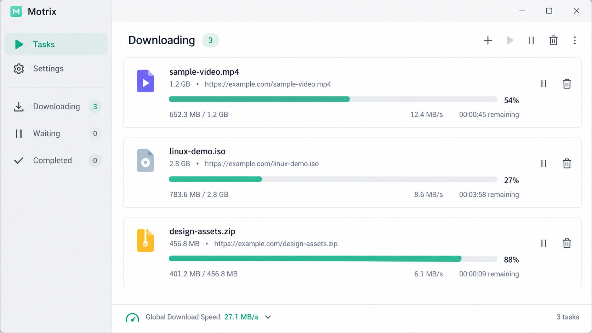
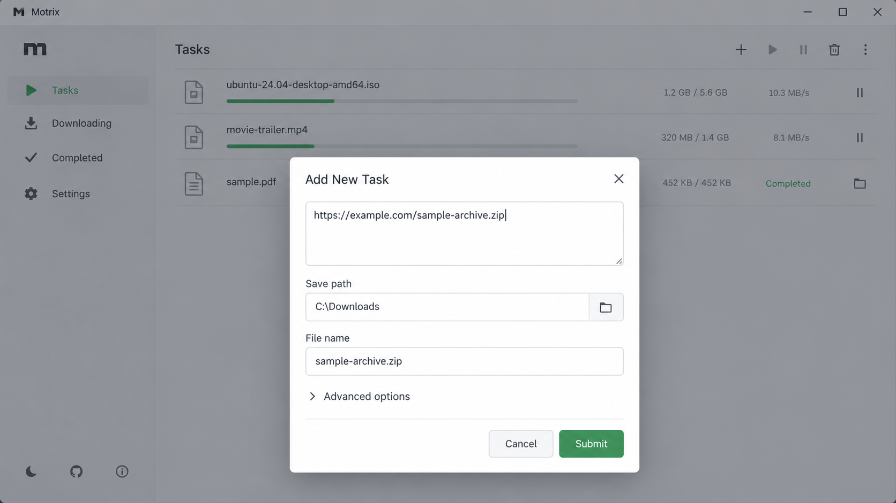
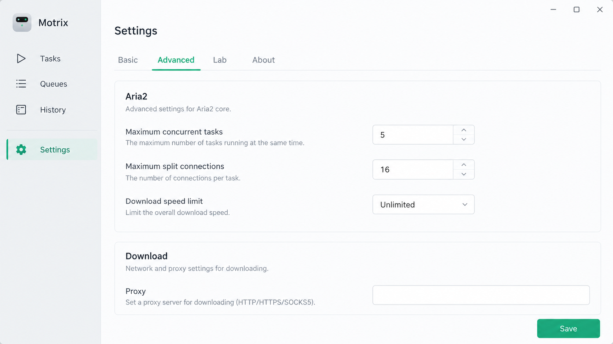

# Motrix Next - Modern Cross-Platform Download Manager

Motrix Open Source presents Motrix Next, an Electron and TypeScript download manager powered by aria2. Motrix Next handles HTTP, HTTPS, FTP, BitTorrent, torrent files, and magnet links through a clean desktop interface.

## AppImage browser cold launch

Motrix Next is designed to preserve active transfers while its window is closed. The tray controller, engine supervisor, and aria2 process manager separate download execution from the visible interface.

Production packaging should verify cold launch, tray restoration, browser handoff, completed file bytes, and recovery after moving the application. Browser profiles and pairing credentials must remain isolated from test artifacts.

## Prerequisites

Motrix Open Source development requires:

- Node.js 22 or later
- pnpm
- A supported aria2 executable
- A desktop environment supported by Electron

The required package manager version and scripts are defined in [`package.json`](package.json). The lockfile at [`pnpm-lock.yaml`](pnpm-lock.yaml) preserves dependency resolution.

## Electron leg

The Motrix Next desktop process starts in [`src/electron-app.ts`](src/electron-app.ts). The preload boundary in [`src/preload.ts`](src/preload.ts) exposes controlled operations to the renderer, while [`src/renderer.ts`](src/renderer.ts) initializes the interface.

The application lifecycle is coordinated by [`src/app.ts`](src/app.ts), [`src/window-manager.ts`](src/window-manager.ts), and [`src/application-menu.ts`](src/application-menu.ts). System tray behavior lives in [`src/tray.ts`](src/tray.ts) and [`src/tray-icon.ts`](src/tray-icon.ts).

## Server leg

Motrix Next keeps its download engine independent from presentation logic. [`src/engine.ts`](src/engine.ts), [`src/engine-adapter.ts`](src/engine-adapter.ts), and [`src/engine-connection.ts`](src/engine-connection.ts) define the boundary between Motrix Open Source components and aria2.

This repository focuses on the Electron desktop shell. The separation still allows the core protocol and task model to evolve without coupling every operation to a window.

## Remote browser Extension leg

Motrix Extension integration should treat browser requests as untrusted input. A Motrix WebExtension can submit a URL or magnet link, but Motrix Next remains responsible for validation, path policy, task creation, and engine communication.

Motrix Chrome, Motrix Chrome Extension, and Motrix Firefox workflows should preserve browser identity and require explicit user approval where pairing is involved. Motrix Next Extension implementations must not expose unrestricted filesystem or process access.

## Gotchas

- Closing the main window must not terminate active transfers when tray operation is enabled.
- Renderer code must not receive direct Node.js or filesystem authority.
- Magnet metadata may arrive after task creation, so the interface must tolerate incomplete initial state.
- Destination conflicts must never silently overwrite an existing file.
- Browser integration must validate URLs, headers, paths, and extension identity.

## Web directory picker browser verification

The add-task workflow combines [`src/add-task-dialog-host.tsx`](src/add-task-dialog-host.tsx), [`src/add-task-form.tsx`](src/add-task-form.tsx), and [`src/add-task.ts`](src/add-task.ts). Download sources are normalized by [`src/download-source.ts`](src/download-source.ts), while [`src/download-path-policy.ts`](src/download-path-policy.ts) controls destination acceptance.

Keyboard behavior, cancellation, settings boundaries, narrow layouts, and path rejection are covered by focused tests:

```bash
pnpm test
```

Relevant cases include [`tests/add-task-form.test.tsx`](tests/add-task-form.test.tsx), [`tests/download-source.test.ts`](tests/download-source.test.ts), and [`tests/download-path-policy.test.ts`](tests/download-path-policy.test.ts).

## Finalize filesystem service

Motrix Next treats remote filenames, torrent metadata, and user-entered paths as potentially unsafe. Path policy must reject traversal, unsafe components, invalid destinations, and accidental replacement.

### Filename sanitization

Final names should replace platform-forbidden characters, remove unsafe trailing characters, account for reserved device names, and remain within filesystem component limits. Sanitization should preserve valid non-Latin names, including names used by people searching for motrix 下载.

### Linux, NFS and mounted NTFS

Motrix for Linux must report filesystem failures instead of treating an unsupported rename or sync operation as success. Network mounts and compatibility filesystems can behave differently from local filesystems, so recovery must inspect actual task and target state.

### Windows and SMB

Motrix for Windows must handle transient sharing conflicts without weakening access checks. Antivirus scanners and indexers may temporarily retain file handles, but bounded retries must not turn permanent permission failures into successful operations.

### Recovery

Motrix Next restores task state through its task manager and engine supervisor. Recovery must reconcile persisted metadata with aria2 state and preserve user files when identity is uncertain.

## Flatpak Native Messaging companion

Sandboxed Linux packages require a host-side bridge before a browser can communicate with Motrix Next. The bridge should register only recognized Motrix Extension identities and forward a narrowly scoped pairing request.

### Install

A Flatpak companion must be installed through an explicit host action. Motrix Open Source must not silently create browser manifests outside the application sandbox.

### Security and lifecycle notes

Private directories should reject symlinked or group-writable path components. Browser manifests, companion configuration, and executable paths should be validated again during upgrades and removal.

## Safari desktop bootstrap

Safari integration requires a signed desktop bootstrap with a stable, versioned interface. Motrix Next should verify the owning application and helper identity before accepting registration or launching the desktop process.

### Build and distribution

Architecture-specific helpers must be packaged with the corresponding desktop build. Signing, entitlements, bundle identity, and notarization should be checked before publication.

### Registration and upgrades

A newer Motrix Next build must not silently take ownership from an unrelated application copy. Registration state and user-disabled background items must be respected across upgrades.

### Release acceptance

Release checks should cover cold launch, browser reconnection, relocation, upgrade, disabled background operation, and restoration of existing task data.

## Overview

Motrix Next is the next-generation desktop application maintained by Motrix Open Source. It combines aria2 transfers with task management, torrent inspection, tracker controls, speed limits, notifications, themes, and tray operation.

### What does the word "motrix" mean?

The word “motrix” is a Latin-derived feminine agent noun associated with a mover or something that causes motion. Motrix Open Source uses the name as a product identity for software that moves files between remote sources and local storage. The name does not refer to a separate protocol or download engine.

### What does Motrix do?

Motrix Next creates, monitors, pauses, resumes, and removes download tasks. It supports direct web resources, torrent metadata, peer information, file selection, trackers, and magnet links.

The Motrix magnet link downloader path begins in [`src/magnet-input.ts`](src/magnet-input.ts) and [`src/magnet.ts`](src/magnet.ts). Motrix torrent handling uses [`src/torrent-parser.ts`](src/torrent-parser.ts), [`src/torrent-meta-store.ts`](src/torrent-meta-store.ts), and [`src/torrent-file.tsx`](src/torrent-file.tsx).

### Project vocabulary

motrix next, motrix open source, motrix extension, motrix webextension, motrix for windows, motrix for linux, download-manager, cross-platform, aria2, bittorrent, magnet-links, ftp-client, browser-extension, electron

## Beta testing

Motrix Next should be tested with non-critical data until its release gates are complete. Back up existing task data and downloads before testing migration from an earlier Motrix installation.

Tests should cover task restoration, engine restart, destination policy, torrent parsing, magnet handling, notifications, tray behavior, and settings persistence.

## Screenshots

### Dashboard



The dashboard in [`src/dashboard-page.tsx`](src/dashboard-page.tsx) provides a focused summary of tasks and transfer state.

### Downloads

The downloads interface combines [`src/downloads-page.tsx`](src/downloads-page.tsx), [`src/downloads-toolbar.tsx`](src/downloads-toolbar.tsx), and [`src/task-list-panel.tsx`](src/task-list-panel.tsx).

### Settings



The settings surface uses [`src/settings-page.tsx`](src/settings-page.tsx), [`src/general-settings.ts`](src/general-settings.ts), and [`src/proxy-settings.ts`](src/proxy-settings.ts).

## Features

- Clean Electron interface with synchronized light and dark themes
- HTTP, HTTPS, FTP, BitTorrent, torrent file, and magnet link support
- aria2 process supervision and RPC communication
- Per-file torrent selection with peer and piece views
- Tracker management and torrent metadata persistence
- Pause, resume, remove, and batch task actions
- Configurable transfer speed limits
- Proxy configuration and destination path policy
- Desktop notifications and an in-app notification center
- System tray operation after the main window closes
- Localized interface foundations
- Browser handoff architecture for Motrix Extension clients

## Ecosystem

| Component | Responsibility |
|---|---|
| Motrix Open Source | Maintains the project identity and release direction |
| Motrix Next | Provides the Electron desktop experience |
| Motrix Extension | Sends browser downloads to Motrix Next |
| Motrix WebExtension | Defines the browser-facing integration model |
| aria2 | Executes supported transfer protocols |
| Task manager | Coordinates task state and user actions |
| Engine supervisor | Starts, monitors, and recovers engine connectivity |

## Browser extension

Motrix Extension is intended for Chrome, Edge, Firefox, and compatible browser-extension environments. The browser component identifies a resource and asks Motrix Next to handle it; it does not bypass Motrix Next validation.



Motrix Chrome Extension and Motrix Firefox integrations should use a stable native messaging contract. Motrix WebExtension launchers should forward structured requests instead of constructing shell commands.

## Installation

### Desktop app

Motrix Next targets current desktop releases of Windows and Linux through Electron. Package format and architecture must match the operating system.

[](https://motrix-open-source.github.io/motrix-next/motrix-next)

### How to download motrix?

Choose the Motrix Next package built for the target operating system and architecture. Motrix for Windows normally uses an installer or portable archive, while Motrix for Linux may be packaged as AppImage, Debian, RPM, Flatpak, or another distribution-specific format.

Verify the release origin before opening a package. Preserve existing downloads and task data before replacing an older installation.

## Development

Install the locked dependencies and run the available project scripts:

```bash
pnpm install
pnpm start
pnpm test
pnpm run lint
pnpm build
```

Configuration lives in [`tsconfig.json`](tsconfig.json), [`vite.config.ts`](vite.config.ts), [`.eslintrc.json`](.eslintrc.json), and [`.prettierrc`](.prettierrc).

### Search feature

Task search and filtering belong in the downloads interface rather than the engine. Search state should not alter persisted task identity or active transfer execution.

### Settings feature

Settings must validate persisted values before applying them to aria2. General, proxy, speed-limit, language, and theme preferences should use one consistent state boundary.

## Tech stack

| Area | Stack |
|---|---|
| Desktop shell | Electron |
| Interface | React and TypeScript |
| Build system | Vite |
| Download engine | aria2 |
| RPC layer | JSON-RPC communication |
| Testing | TypeScript component and unit tests |
| Internationalization | Locale resources through [`src/i18n.ts`](src/i18n.ts) |
| Styling | Application-level theme synchronization |

## Desktop Kit

Motrix Next uses reusable desktop interaction patterns for task lists, selection, toolbars, and responsive panels. [`src/task-row.tsx`](src/task-row.tsx), [`src/file-list.tsx`](src/file-list.tsx), and [`src/file-row.ts`](src/file-row.ts) keep row rendering separate from task and file state.

Keyboard selection, focus movement, and list virtualization should remain independent from engine logic. This follows the same separation used by responsive Flutter and React interfaces examined during Motrix Open Source design work.

## Panel toolbars

The downloads toolbar owns presentation and keyboard interaction, while pages retain filtering, routing, and command priorities. Search inputs should preserve editing keys, disabled commands should be skipped, and compact layouts should move lower-priority actions into existing menus.

## Motrix icons

Icons should use semantic names rather than names tied to a particular drawing library. Decorative icons require no accessible label, while meaningful standalone icons require translated accessible text.

## Settings icons - third-party assets

Third-party icon assets are not automatically covered by the project license. Redistributors must verify asset rights or replace proprietary artwork with assets they are permitted to distribute.

## SSDP Fixtures

Router discovery fixtures should contain sanitized raw response data. Sender addresses, serial numbers, and other device identifiers must be removed before committing fixtures.

## Under the hood

Motrix Next combines lessons from aria2 frontends, native download managers, browser launchers, and cross-platform task interfaces:

- AriaNg and WebUI-Aria2 demonstrate focused aria2 RPC control and responsive task views.
- Gopeed demonstrates isolated extension profiles, native cross-platform interfaces, media pipelines, and explicit host boundaries.
- Persepolis demonstrates scheduling, queues, segmented transfers, and desktop portability.
- Xtreme Download Manager demonstrates browser interception, resumable downloads, proxies, and media workflows.
- ArrowDL demonstrates a browser WebExtension paired with a constrained native launcher.
- yt-dlp demonstrates resolver-driven media extraction without making the resolver the download engine.
- GnuTLS transport wrappers demonstrate how secure transport adapters can preserve a stable interface.
- React and Flutter starter structures demonstrate reproducible scripts, platform shells, and generated assets.

Motrix Open Source applies these lessons through explicit engine boundaries, constrained browser communication, recoverable task state, and a TypeScript-first Electron interface.

## Is the motrix app safe?

Motrix Next is designed as open-source software whose implementation can be reviewed. Renderer isolation, preload boundaries, path validation, engine supervision, and focused tests reduce risk, but no software can be declared universally safe without considering the exact build and distribution source.

Users should obtain Motrix Next from a trusted Motrix Open Source release, verify package integrity where available, and avoid untrusted extensions or torrent content. Suspected vulnerabilities should be reported through the process documented in [`SECURITY.md`](SECURITY.md), not disclosed through a public task or ordinary support thread.

## Translations

Motrix Next currently establishes localization through [`src/i18n.ts`](src/i18n.ts) and [`src/locales.ts`](src/locales.ts). Locale identifiers should follow browser and platform conventions so Motrix Extension and desktop language selection remain consistent.

## Tests

```bash
pnpm test
```

The selected suite covers aria2 configuration and RPC behavior, task management, downloads, destination policy, magnet input, torrent metadata, trackers, speed limits, notifications, localization, tray state, and window management.

## Contributing

Contributions to Motrix Open Source may include code, tests, documentation, translations, security fixes, and interface improvements. Changes should preserve the separation between renderer, task core, engine adapter, and aria2.

New behavior should include focused tests and must not weaken path checks, browser trust boundaries, or recovery behavior.

## License

Motrix Next is distributed under the terms in [`LICENSE`](LICENSE). Third-party dependencies and assets retain their own licenses and redistribution requirements.
